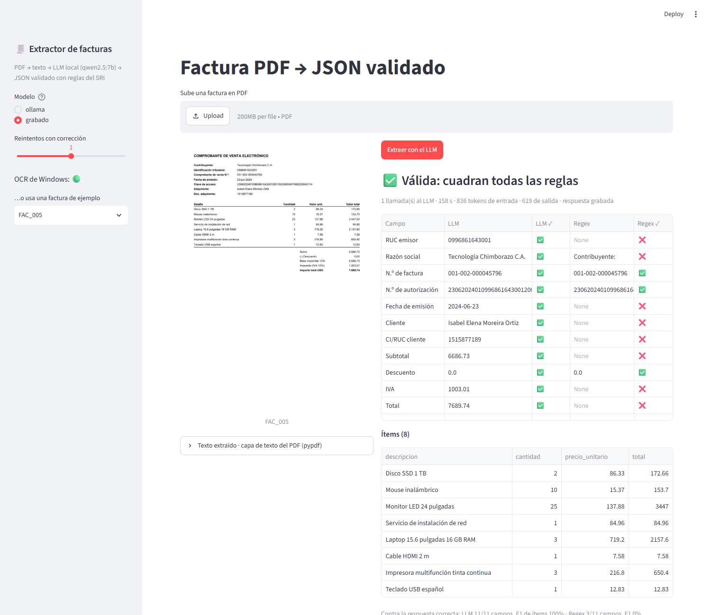

🇺🇸 **English (summary)** · 🇪🇸 [Español (full version)](README.es.md)

# 🧾 PDF invoice extraction to validated JSON (local LLM + Ecuador's SRI rules)

Turns Ecuadorian PDF invoices (digital, **scanned** or **rotated**) into structured JSON **validated with business rules**: tax
ID and access key with check digits, items that add up to the subtotal, subtotal − discount + VAT = total, 12% or 15% VAT
depending on the date. It runs **100% locally and for free**: pypdf, the OCR built into Windows and `qwen2.5:7b` on Ollama, on a
PC **without a GPU**. It was compared with a regular-expression baseline on 200 synthetic invoices with 5 layouts, one of them
**never seen** when writing the regex or the prompt.

## Results

Same sample of **50 invoices** for every method (stratified: 20 scanned/rotated, 10 with missing fields). 95% CI in brackets.

| Method | Exact fields | Item F1 | 100% correct invoices | Time per invoice |
|---|---:|---:|---:|---:|
| Regex (baseline) | 81.8% [73.3–89.6] | 78.2% [68.0–86.5] | 52% [39–65] | **0.9 ms** |
| **LLM + validation + retry** (measured) | **97.5%** [96.0–98.7] | **96.1%** [91.6–99.3] | **70%** [56–81] | ~2 min |
| LLM + deterministic repairs ¹ | 98.2% [96.7–99.5] | 97.2% [93.0–100] | 82% [69–90] | ~2 min |
| **Cascade: regex → LLM only if the regex does not validate** ¹ | **98.9%** [97.8–99.8] | **97.2%** [93.0–100] | **86%** [74–93] | LLM on **46%** of the 50 |

¹ The repairs were written **after** seeing the run's errors: these figures are optimistic, and the CIs of the three LLM rows
overlap.

| Where the difference shows | Regex | LLM (measured) |
|---|---:|---:|
| **Layout E, never seen**, n = 10 | **0%** perfect [0–28] | **60%** perfect [31–83] |
| **Scanned or rotated** (OCR), n = 20 | **10%** perfect [3–30] | **60%** perfect [39–78] |
| Digital, layouts A–D (the ones it was written for) | **100%** (135/135 of the 200) | 79% (19/24 of the sample) |
| Fields that are NOT printed: null or invented? | 12/12 null | 11/12 null · **1 invented** |

- The retry with correction fixed **0 of 3** retried invoices (the 3 scanned ones with damaged OCR).
- LLM cost: mean 134 s, p90 205 s per invoice.

**Honest reading, figures, architecture and reproduction commands:** [full README (Spanish)](README.es.md). Commands are
language-independent.
