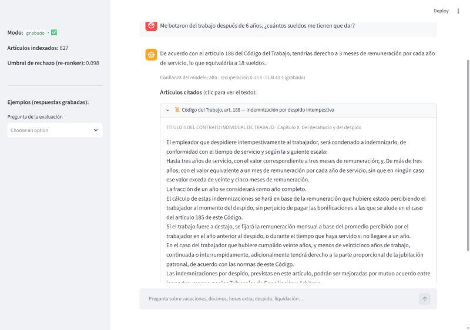

🇺🇸 **English (summary)** · 🇪🇸 [Español (full version)](README.es.md)

# ⚖️ RAG assistant for Ecuador's labor law (hybrid search + re-ranking + refusal)

Answers questions from workers and small businesses (vacations, bonuses, overtime, dismissal, severance) **citing the exact
article** of the Labor Code (607 articles, last reform 2026-04-09) and the Constitution (20 labor articles), and **says it does
not know** when the loaded law does not cover it. It runs 100% locally and for free (qwen2.5:7b + bge-m3 on Ollama,
bge-reranker-v2-m3 on CPU) and was evaluated piece by piece with **145 hand-written and hand-verified questions** (120 with
their correct article and 25 traps).

> ⚠️ **It does not replace a lawyer.** The evaluation itself shows that the model makes calculation mistakes; that is why the
> citation is always shown next to the answer.

## Retrieval: does the right article reach the 5 that the LLM reads?

Main set (100 answerable questions), 95% CI in brackets:

| Method | Recall@5 | MRR@20 | Correct article in 1st place |
|---|---:|---:|---:|
| BM25 (**baseline**) | 0.76 [0.67–0.84] | 0.60 [0.52–0.67] | 46% |
| Vector search, bge-m3 | 0.97 [0.93–1.00] | 0.87 [0.82–0.92] | 79% |
| Hybrid (RRF) | 0.92 [0.87–0.97] | 0.76 [0.69–0.82] | 63% |
| **Hybrid + re-ranking** (what the assistant uses) | **0.97** [0.93–1.00] | **0.92** [0.88–0.96] | **88%** |

On the 20 **new** questions (not used to tune anything), hybrid + re-ranking gets Recall@5 0.85 [0.70–1.00]. With 20
questions, each one is worth 5 points and the intervals are wide.

## Generation and refusal (qwen2.5:7b, 145 answers, 0 format errors)

| Metric | Main (100 + 20 traps) | New (20 + 5 traps) |
|---|---:|---:|
| **Cites the correct article** | **87%** | **85%** |
| … if the correct article was in the context | 90% | 100% |
| **Refuses the traps** (LLM only → + re-ranker threshold) | 95% → **100%** | 80% → 80% |

**Full evaluation, limitations, architecture and reproduction commands:** [full README (Spanish)](README.es.md). Commands are
language-independent.
