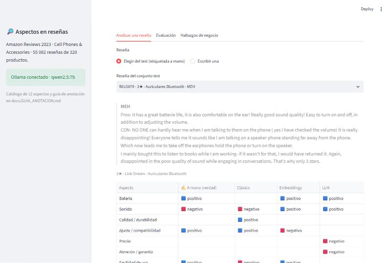

🇺🇸 **English (summary)** · 🇪🇸 [Español (full version)](README.es.md)

# 🔎 Aspect-based sentiment in Amazon reviews: rules vs. embeddings vs. local LLM

**What** do customers of phones and accessories complain about, and **how many stars does it cost** the brands? For each review
the system extracts the aspects it mentions (battery, charging, screen, sound, quality, fit, design, protection, price,
shipping, support, ease of use) with their polarity and the **verbatim quote** that justifies it. **Three approaches** were
compared against **700 hand-labeled reviews** —80 of them in Spanish— and the most cost-effective one was applied to **55,082
reviews** of 320 products (Amazon Reviews 2023). Everything runs **locally and for free** on a PC without a GPU.

## Results (test: 320 hand-labeled reviews, 546 aspect mentions)

| Approach | Aspect detection F1 | Aspect + polarity F1 | Polarity accuracy | Global sentiment accuracy | Cost per review (CPU) |
|---|---:|---:|---:|---:|---:|
| **1 · Classic**: pattern dictionary + TF-IDF + logistic regression | 0.722 (0.70–0.75) | 0.550 (0.51–0.59) | 0.762 | 0.797 | **1.4 ms** |
| **2 · Embeddings** `bge-m3` + logistic regressions | **0.739** (0.71–0.77) | 0.621 (0.58–0.65) | 0.841 | **0.816** | 0.97 s |
| **3 · LLM** `qwen2.5:7b`, pydantic structured output | 0.688 (0.65–0.72) | **0.629** (0.59–0.66) | **0.914** | 0.694 | 19.5 s |

95% CI (bootstrap over reviews) in parentheses. On the Spanish part (80 reviews; nothing was tuned with Spanish), aspect F1 is
0.50 for the classic approach, **0.70** for embeddings and 0.69 for the LLM.

- **None dominates:** in aspect detection the three intervals overlap. The LLM gets the polarity right (0.91) but **detects
  fewer aspects** and is the worst at global sentiment.
- **The classic approach is 0.02 F1 behind in detection (within the CI)** at a cost **690 times lower** than embeddings and
  ~14,000 times lower than the LLM, so it was chosen for the 55,082 reviews (2.2 min; the LLM would take ~12 days of CPU).
- **Label quality:** a second labeling pass over 160 test reviews gives a mean kappa of 0.96 per aspect.

**Business findings, figures, limitations and reproduction commands:** [full README (Spanish)](README.es.md). Commands are
language-independent.
